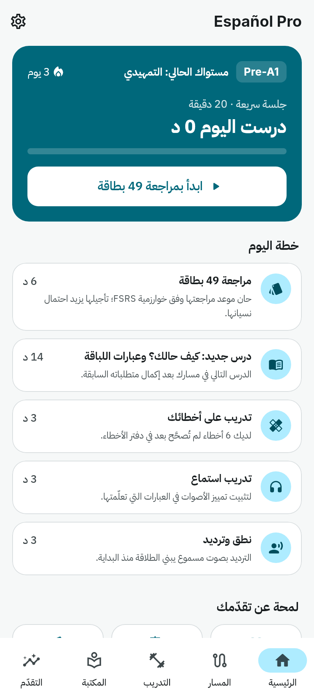
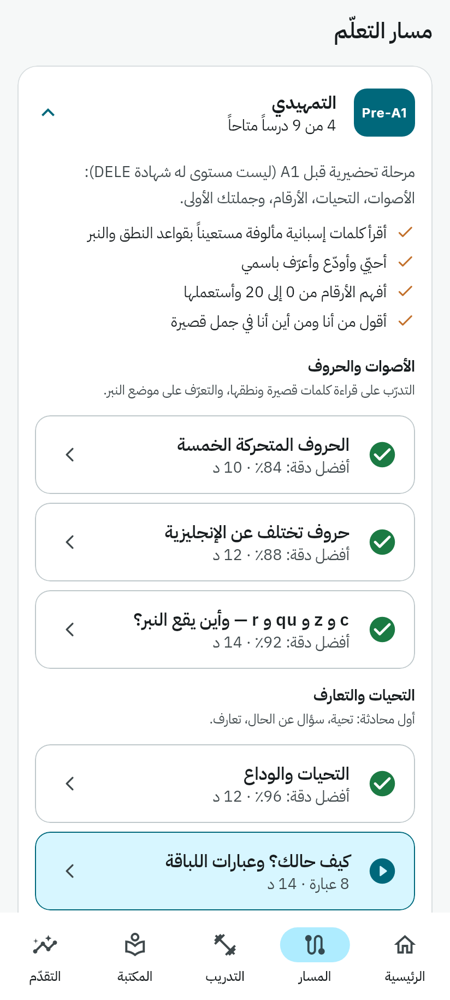
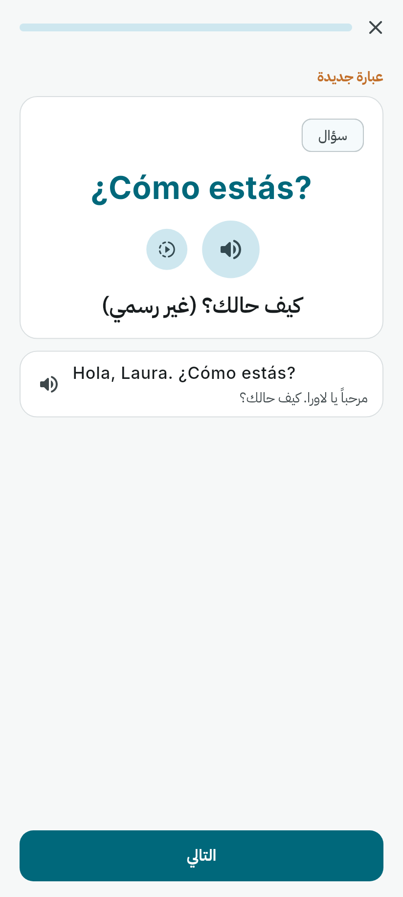
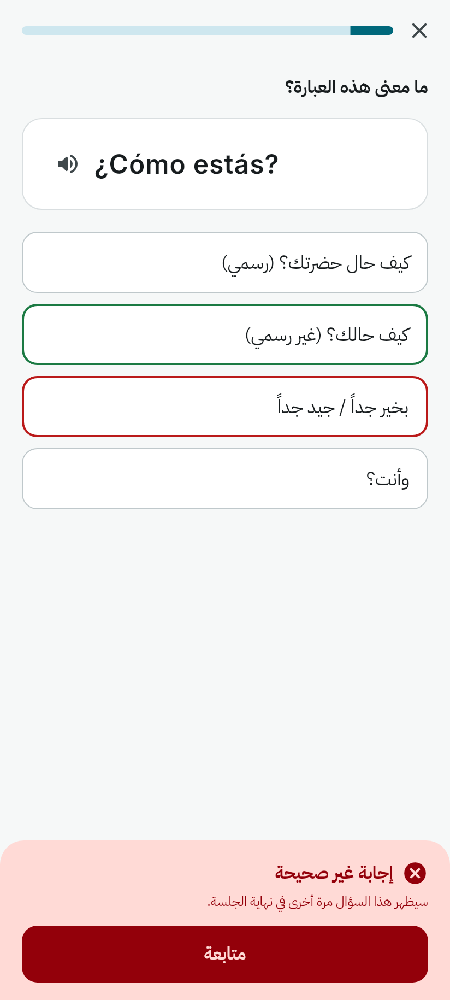

# Español Pro

A private, single-user, offline-first Android app that takes an Arabic-speaking
professional from zero Spanish toward working proficiency (Pre-A1 → C2 roadmap,
B2 as the first professional milestone). Arabic RTL interface, Spanish LTR
content, FSRS spaced repetition, no accounts, no ads, no tracking.

> **Status: Phase 1 (educational foundation) implemented and under review.**
> What is and is not done is tracked honestly in
> [`docs/IMPLEMENTATION_STATUS.md`](docs/IMPLEMENTATION_STATUS.md).
> AI tutor, voice conversation and pronunciation scoring are **not** implemented.

| Home | Learning path | Lesson | Feedback |
|---|---|---|---|
|  |  |  |  |

## What works today

- 74 original lessons (9 Pre-A1, 23 A1, 25 A2, 17 B1), 621 vocabulary items,
  1329 graded exercises, 82 grammar notes, 42 dialogues, 19 checkpoints and
  level tests, a 68-verb conjugation reference (present, past, and from B1
  the imperfect, the conditional and the present subjunctive) — plus the
  full Pre-A1 → C2 curriculum map.
- From B1, missing written accents count as mistakes, and selected reading
  and listening instructions are in Spanish first (Arabic one tap away).
- B1 opens only after passing the A2 level test (every can-do at ≥ 75 %);
  the path, the lesson and the home screen explain this in Arabic.
- Lesson engine with 11 exercise types (meaning choice, listening, dictation,
  fill-in, sentence ordering, matching, typed translation, situational reply,
  listen-and-repeat…). Wrong answers are explained, retried and logged.
- FSRS-6 spaced repetition (recognition + active-production cards).
- Deterministic, explainable daily plan for 20 / 45 / 60-minute sessions.
- Personal dictionary, grammar reference, error notebook, progress analytics.
- Spanish audio through the device text-to-speech engine (offline).
- JSON backup export / restore; SQLite with tested migrations.

## Build and run

Requirements: Flutter **3.50.0** (stable), Android SDK, JDK 17.

```bash
flutter pub get
flutter run                 # on a connected Android device / emulator
flutter build apk --debug   # build/app/outputs/flutter-apk/app-debug.apk
```

For Spanish audio the device needs a Spanish text-to-speech voice
(Android: Settings → System → Languages → Text-to-speech output → install
Spanish voice data). Without it the app still works and says so.

## Verify

```bash
dart format --output=none --set-exit-if-changed lib test tool test_screenshots
flutter analyze --fatal-infos
dart run tool/validate_content.dart   # content package validation
flutter test                          # unit + widget tests
flutter test test_screenshots --update-goldens   # regenerate docs/screenshots
```

After changing `lib/core/db/database.dart`: `dart run build_runner build`.

CI (`.github/workflows/ci.yml`) runs all of the above and builds the debug APK.

## Documentation

| Document | Contents |
|---|---|
| [`docs/ARCHITECTURE.md`](docs/ARCHITECTURE.md) | Requirements, structure, dependency decisions, security, testing |
| [`docs/CURRICULUM.md`](docs/CURRICULUM.md) | Curriculum map, lesson model, pedagogy |
| [`docs/CONTENT_SCHEMA.md`](docs/CONTENT_SCHEMA.md) | Content package format and validation rules |
| [`docs/DATABASE.md`](docs/DATABASE.md) | Schema diagram, migrations, backup format |
| [`docs/ROADMAP.md`](docs/ROADMAP.md) | Phases 1–5 with acceptance criteria |
| [`docs/IMPLEMENTATION_STATUS.md`](docs/IMPLEMENTATION_STATUS.md) | Implemented / tested / incomplete / blocked |
| [`docs/REVIEW_HANDOFF.md`](docs/REVIEW_HANDOFF.md) | How to inspect, build, test and evaluate |
| [`AI_BRIDGE/PROJECT_PLAN.md`](AI_BRIDGE/PROJECT_PLAN.md) | Full project plan: every requirement with done / partial / not started / blocked |
| [`AI_BRIDGE/`](AI_BRIDGE/) | Implementer ↔ reviewer handoff protocol |

## Privacy

Everything stays on the device. Phase 1 makes no network requests, has no
analytics and needs no secrets (see `.env.example`).
