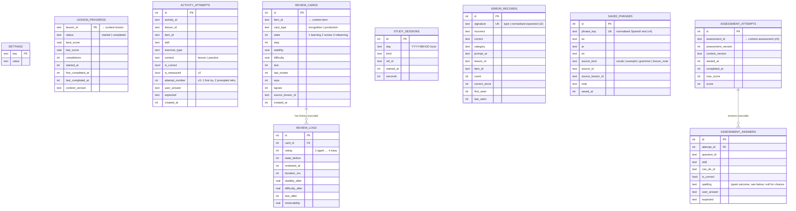

# Database

SQLite via Drift. File: `espanol_pro.sqlite` in the app documents directory.
Schema version **5**. Source: `lib/core/db/database.dart`.

Only learner-generated data is stored. Curriculum entities (levels, units,
lessons, vocabulary, grammar, sources, licences) live in the versioned content
package and are referenced by stable string IDs — see ARCHITECTURE §3.
All timestamps are UTC epoch milliseconds; `study_sessions.day` is the local
calendar day fixed at write time.



Constraints and indexes: `UNIQUE(review_cards.item_id, card_type)` — one card
per item and direction, so repeating a lesson cannot duplicate cards ·
`idx_review_cards_due` · `idx_review_logs_card` · `idx_attempts_created` ·
`idx_sessions_day` · `idx_assessment_answers_attempt` · foreign keys enforced (`PRAGMA foreign_keys = ON`).

## Mapping to the specification's entity list

| Spec entity | Where it lives |
|---|---|
| UserSettings | `settings` |
| LessonProgress, ActivityAttempt, ReviewCard, ReviewHistory, ErrorRecord, DailyStudySession | tables above |
| VocabularyKnowledge | derived: `review_cards` state per item |
| SkillObservation | derived: `activity_attempts` grouped by skill |
| LearningRecommendation | computed on demand by `buildDailyPlan` (not stored) |
| CurriculumLevel/Unit, Lesson, LearningObjective, LessonActivity, VocabularyItem, Sentence, GrammarConcept, ContentSource, ContentLicense | content package (JSON) |
| BackupMetadata | header of the backup document |
| UserProfile | not needed for a single user without accounts |
| AudioAsset | not applicable yet (device TTS, no audio files) |
| Assessment (definition) | content package (`assessments/*.json`) |
| AssessmentResult | `assessment_attempts` + `assessment_answers` (v5) |
| PronunciationAttempt, ConversationSession/Message, WorkScenario | Phase 2–4, not created yet |

## Saved phrases (v4)

Identity is `phrase_key`, the Spanish text normalised like a typed answer
(case, punctuation and spacing ignored; accents and ñ kept). It does not
depend on a content id, so a saved phrase survives curriculum edits, and the
same sentence saved from two screens (or two lessons) is one row that
keeps its first source, date and note. Saved phrases are a personal
library, not progress: **Reset progress keeps them**, and **restoring a
backup from before v4 leaves them untouched** instead of deleting them. The restore
preview says so explicitly for such a file. A v4
backup must contain the table and replaces it. They do not create FSRS cards
yet; if they ever do, the card's `item_id` will be `phrase:<phrase_key>` so it
cannot collide with curriculum items.

## Assessment results (v5)

A checkpoint is defined in the content package; only what the learner
submitted is stored. `AssessmentRepository.submit` writes the attempt row and
**all** its answers in one transaction: a row in `assessment_attempts` always
means a complete submission, and a failed write stores nothing (tested with a
SQLite trigger that aborts the answer insert). Abandoned attempts are never
stored. Each attempt is a new row — retakes never overwrite or average
earlier results. `assessment_version` records which definition was taken, so
a later edit of the questions never reinterprets an old result.

`score`/`max_score` count objectively graded questions only; speaking is never
measured. `spelling` stores the outcome of a typed answer, so that
"meaning right, accents missing" is never hidden inside `is_correct`:

| value | `is_correct` | meaning |
|---|---|---|
| `exact` | true | matches an accepted answer |
| `missing_accents` | true | only accents differ, none of them changes the meaning |
| `accent_meaning` | false | a meaning-bearing accent is missing or wrong (si/sí, tu/tú, el/él …) |
| `enye` | false | ñ written as n (or the reverse) |
| `word_order` | false | the same words in another order |
| `grammar_form` | false | one word has the wrong ending, plural or article |
| `spelling` | false | a near miss of the right word |
| `meaning` | false | a different answer |
| `wrong` | false | an empty answer, or a wrong answer stored before 1.2C |

The column is text and the change is additive: no migration was needed. Assessments never write to
FSRS cards, lesson progress, `activity_attempts` or the error notebook.
Can-do states are derived from these rows, never stored
(`CanDoEvidence` in `lib/core/assessment/assessment_engine.dart`, also
explained on the progress screen): a can-do is *met* in an attempt when at
least 75 % of its questions are right; latest attempt not met → needs
practice; met → demonstrated; the latest two both met on different local days
→ consistent. Completing lessons never changes these states.

Reset progress deletes assessment results (they are progress); saved phrases
are kept. A backup from before v5 leaves the device's results untouched.

## Migrations

Rule: migrations are additive and never drop learner data.

| Version | Change |
|---|---|
| 1 | settings, lesson_progress, activity_attempts, review_cards, review_logs, study_sessions |
| 2 | + `error_records` table · + `activity_attempts.is_measured` (default true) |
| 3 | + `activity_attempts.attempt_number` (default 1) — separates first attempts from prompted retries |
| 4 | + `saved_phrases` table — the learner's saved sentences |
| 5 | + `assessment_attempts`, `assessment_answers` tables — checkpoint results |

`test/persistence_test.dart` builds real v1 and v2 database files from the
verbatim historical DDL (and v3/v4 files by removing later tables from the
current schema), fills them, opens them with the current code and
asserts that every row survives, new columns default correctly, new tables
work and `user_version` becomes the latest. Add a fixture + test for every future version.

## Backup format

```jsonc
{ "format": "espanol-pro-backup", "schema_version": 3,
  "content_version": "1.0.0", "exported_at": "…Z",
  "tables": { "settings": [], "lesson_progress": [], "activity_attempts": [],
              "review_cards": [], "review_logs": [], "study_sessions": [],
              "error_records": [], "saved_phrases": [],          // v4
              "assessment_attempts": [], "assessment_answers": [] } } // v5
```

Restore is validate-then-replace. Before anything is deleted it requires:
a known `schema_version` (1 … latest); **every table of that schema version
present as a list** (a missing table is an error, never "empty"); every row
parseable; unique primary and natural keys; every review log pointing at a
card in the same file; ratings and card states in range; every assessment answer pointing at an attempt in the file, each attempt's `score`/`max_score` equal to its answers, versions ≥ 1, `completed_at ≥ started_at`, and valid spelling values. Only then are all
tables replaced in one transaction. Foreign, newer, truncated, inconsistent
or damaged files are rejected with the database byte-for-value unchanged
(tested on row values, not counts). Backups from schema 1 and 2 restore, with
documented defaults for columns added later. The UI shows the file's row
counts and asks for confirmation before restoring.
