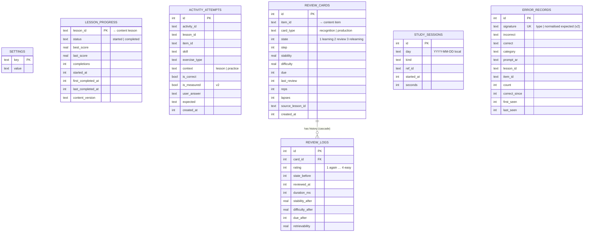

# Database

SQLite via Drift. File: `espanol_pro.sqlite` in the app documents directory.
Schema version **2**. Source: `lib/core/db/database.dart`.

Only learner-generated data is stored. Curriculum entities (levels, units,
lessons, vocabulary, grammar, sources, licences) live in the versioned content
package and are referenced by stable string IDs — see ARCHITECTURE §3.
All timestamps are UTC epoch milliseconds; `study_sessions.day` is the local
calendar day fixed at write time.



Constraints and indexes: `UNIQUE(review_cards.item_id, card_type)` — one card
per item and direction, so repeating a lesson cannot duplicate cards ·
`idx_review_cards_due` · `idx_review_logs_card` · `idx_attempts_created` ·
`idx_sessions_day` · foreign keys enforced (`PRAGMA foreign_keys = ON`).

## Mapping to the specification's entity list

| Spec entity | Where it lives |
|---|---|
| UserSettings | `settings` |
| LessonProgress, ActivityAttempt, ReviewCard, ReviewHistory, ErrorRecord, DailyStudySession | tables above |
| VocabularyKnowledge | derived: `review_cards` state per item |
| SkillObservation | derived: `activity_attempts` grouped by skill |
| LearningRecommendation | computed on demand by `buildDailyPlan` (not stored) |
| CurriculumLevel/Unit, Lesson, LearningObjective, LessonActivity, VocabularyItem, Sentence, GrammarConcept, ContentSource, ContentLicense | content package (JSON) |
| BackupMetadata | header of the backup document |
| UserProfile | not needed for a single user without accounts |
| AudioAsset | not applicable yet (device TTS, no audio files) |
| PronunciationAttempt, ConversationSession/Message, Assessment/Result, WorkScenario | Phase 2–4, not created yet |

## Migrations

Rule: migrations are additive and never drop learner data.

| Version | Change |
|---|---|
| 1 | settings, lesson_progress, activity_attempts, review_cards, review_logs, study_sessions |
| 2 | + `error_records` table · + `activity_attempts.is_measured` (default true) |

`test/persistence_test.dart` builds a real v1 database file from the verbatim
v1 DDL, fills it, opens it with the current code and asserts that every row
survives, the new column defaults correctly, the new table works and
`user_version` becomes 2. Add a fixture + test for every future version.

## Backup format

```jsonc
{ "format": "espanol-pro-backup", "schema_version": 2,
  "content_version": "1.0.0", "exported_at": "…Z",
  "tables": { "settings": [], "lesson_progress": [], "activity_attempts": [],
              "review_cards": [], "review_logs": [], "study_sessions": [],
              "error_records": [] } }
```

Restore parses and validates the whole document first, then replaces all data
in one transaction; newer-schema, foreign or damaged files are rejected with
the database untouched (tested). Older backups (schema 1) restore.
